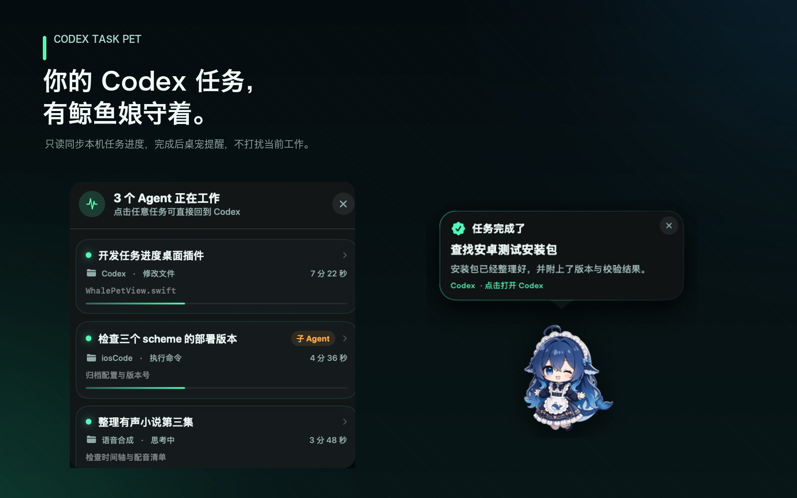
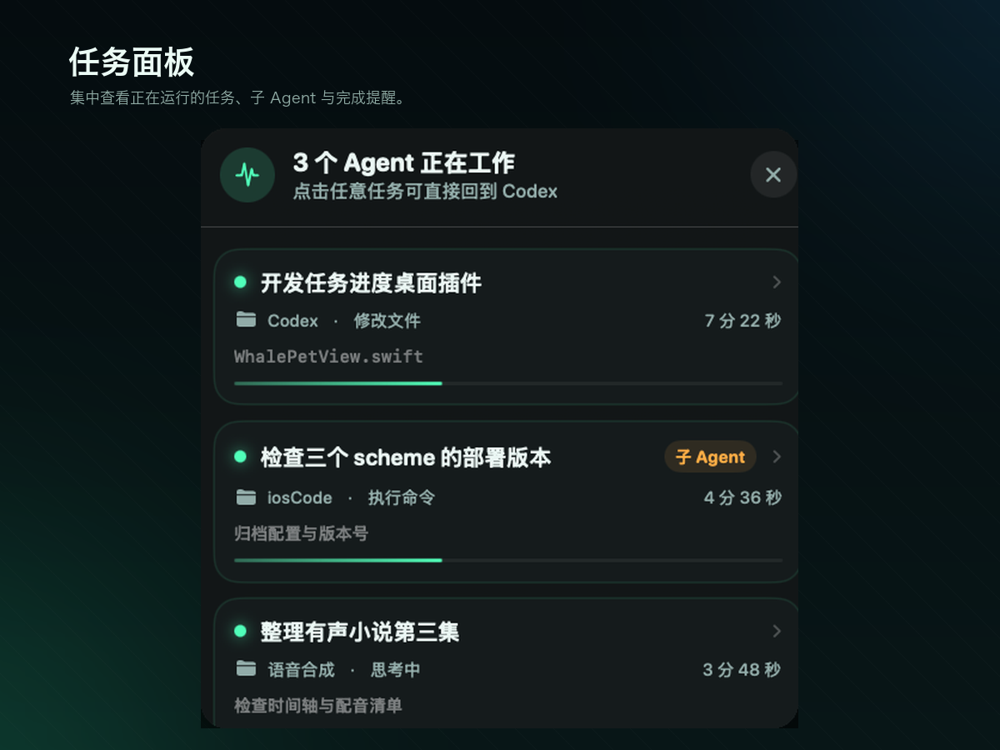
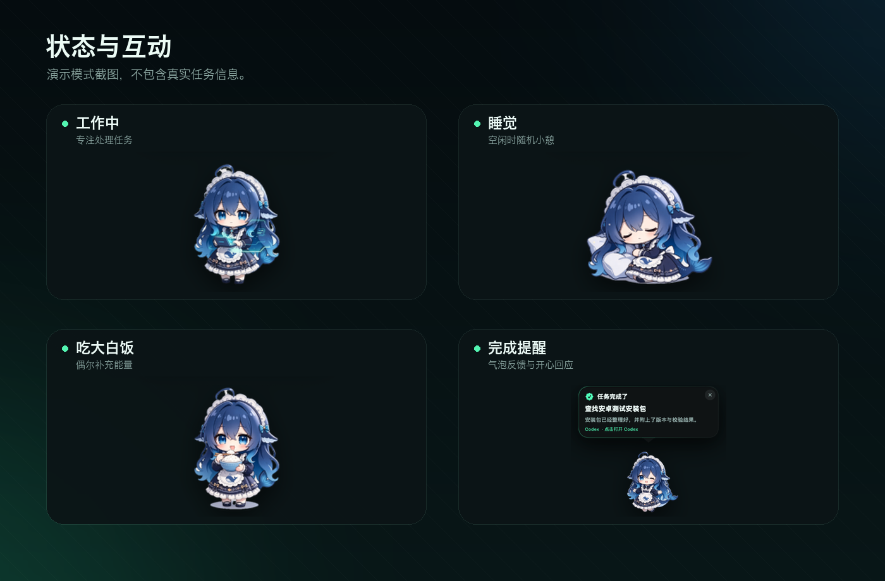
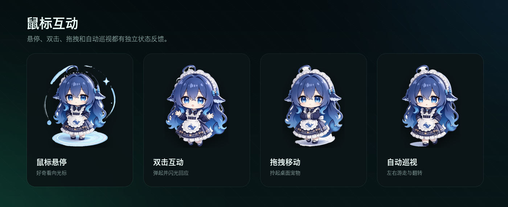

# Codex 任务宠物 · 鲸鱼娘

一个常驻 macOS 桌面的 Codex 任务宠物。它会只读同步本机 Codex 任务进度，用鲸鱼娘的姿态、状态气泡和完成提醒陪伴每一次 Agent 工作。



## 功能特性

- **任务进度同步**：读取本机 Codex SQLite 数据，展示正在运行的任务、子 Agent、当前动作和最近完成记录。
- **一键回到 Codex**：点击任务卡片，通过 `codex://` 深链打开对应任务。
- **鲸鱼娘状态反馈**：待机、工作、开心、生气、睡觉、吃大白饭，以及悬停、双击、拖拽、巡视等互动状态。
- **随机生活行为**：空闲时随机小憩或吃大白饭，不运行机械的高频轮询。
- **完成提醒**：任务完成后显示气泡、播放提示音，并让鲸鱼娘进入开心状态。
- **桌面交互**：支持拖拽移动、双击互动、自动巡视、大小缩放和右键菜单。
- **轻量常驻**：无第三方运行时依赖，内置图片缩略、缓存、SQLite 文件指纹和低频刷新策略。
- **演示模式**：使用虚构数据展示全部界面，不读取真实任务。

## 界面预览

### 任务面板

集中查看正在运行的任务、子 Agent、当前动作和运行时长。



### 状态反馈

工作、睡觉、吃大白饭和任务完成提醒。



### 鼠标互动

悬停、双击、拖拽与自动巡视均有独立状态。



## 鲸鱼娘状态

| 状态 | 资源文件 | 说明 |
| --- | --- | --- |
| 待机 | `standby.png` | 安静站立，平稳待机 |
| 工作中 | `working.png` | 专注处理任务 |
| 开心 | `happy.png` | 任务完成后开心回应 |
| 生气 | `angry.png` | 任务失败或读取异常时反馈 |
| 睡觉 | `sleep.png` | 随机小憩或通过菜单进入 |
| 吃大白饭 | `eat_rice.png` | 随机补充能量或通过菜单触发 |
| 鼠标悬停 | `hover.png` | 好奇看向鼠标 |
| 双击互动 | `double_click.png` | 弹起并出现微光 |
| 拖拽移动 | `drag.png` | 被拎起并跟随鼠标移动 |
| 自动巡视 | `patrol.png` | 在桌面左右游走，按方向镜像 |

所有透明底 PNG 位于 [`Sources/Resources/Whale`](Sources/Resources/Whale)，运行时最长边会缩放到 512 px。

## 随机睡觉与吃大白饭

随机行为只在**真正空闲**时发生：没有运行中的任务、完成提醒、错误、拖拽、悬停、双击、任务面板、巡视、睡觉或吃饭行为。

- 启动后等待约 35～75 秒进行第一次检查。
- 空闲时以各 50% 的概率随机睡觉或吃大白饭。
- 随机睡觉持续约 25～45 秒。
- 随机吃大白饭持续约 4.5～6 秒。
- 行为结束后等待约 75～150 秒再检查。
- 状态忙碌时不做高频轮询，而是等待约 45～90 秒后重试。
- 用户开始拖拽、悬停、双击、打开面板或主动进入其他状态时，会中断随机行为。

也可以在右键菜单中手动选择“让她睡一会儿”“喂一碗大白饭”或“自动巡视桌面”。

## 系统要求

- macOS 14 Sonoma 或更高版本
- 本机安装 Codex
- 从源码构建需要 Swift 5.10+ / Xcode Command Line Tools

## 编译与运行

```bash
# Release 编译
./scripts/build.sh release

# 直接运行演示模式，不读取真实任务
swift run AgentPet --demo

# 打包为 .app
./scripts/package.sh
open "dist/Codex 任务宠物.app"
```

也可以直接运行：

```bash
swift run AgentPet
```

非演示模式会读取本机 Codex 数据。如果数据文件不存在，鲸鱼娘会显示异常状态。

## 使用方式

- **单击鲸鱼娘**：展开或收起任务面板。
- **双击鲸鱼娘**：触发弹起和闪光反馈。
- **拖动鲸鱼娘**：移动到桌面任意可见位置。
- **右键鲸鱼娘**：打开菜单，可切换睡觉、吃饭、巡视、大小、提示音和开机自启动。
- **点击任务卡片**：打开 Codex 中对应任务。

窗口位置、大小和声音设置会保存在本机 `UserDefaults` 中。

## 隐私说明

- 应用**不联网**，没有遥测、账号系统或云端上传逻辑。
- 仅以只读方式访问以下本机文件：
  - `~/.codex/state_5.sqlite`
  - `~/.codex/thread_history_1.sqlite`
- 任务标题、项目名和当前动作只在本机界面中展示。
- 不会修改 Codex 数据库，也不会复制任务正文到其他位置。
- 点击任务时只调用 `codex://threads/<task-id>` 深链。

## 性能设计

- 任务轮询间隔为 3 秒，并设置 0.75 秒 Timer 容差。
- 使用 SQLite 文件时间与大小组成数据版本；没有变化时跳过查询。
- SQLite 以只读、无互斥模式打开，并限制缓存大小。
- 鲸鱼娘图片通过 ImageIO 生成最长边 512 px 的缩略图。
- `NSCache` 限制为最多 4 张图片、约 6 MB。
- 自动巡视以 20 fps 更新窗口位置。
- 呼吸动画只在待机和工作中运行。
- 任务面板关闭后释放 Popover，减少常驻视图和内存占用。
- 定时器统一由主 RunLoop 管理，不创建后台查询线程。

## 项目结构

```text
Sources/
├── App/          # 应用入口与生命周期
├── Models/       # 任务、完成事件和桌宠状态模型
├── Services/     # Codex 数据库、任务轮询、开机启动
├── Views/        # 桌宠、交互、任务面板和窗口控制
└── Resources/    # 鲸鱼娘图片与应用图标
Support/          # Info.plist
scripts/          # 编译与应用打包脚本
docs/screenshots/ # README 演示截图
```

## 参与贡献

请先阅读 [CONTRIBUTING.md](CONTRIBUTING.md)。截图或问题反馈中不要包含真实任务内容、用户名、路径或其他敏感信息。

## 许可证

- **源代码**采用 [MIT License](LICENSE)。
- **鲸鱼娘图片、应用图标和截图中的美术资源不自动适用 MIT License**，授权范围见 [ASSETS.md](ASSETS.md)。

Codex 是 OpenAI 的产品。本项目和本项目作者与 OpenAI 不存在隶属或官方合作关系。
